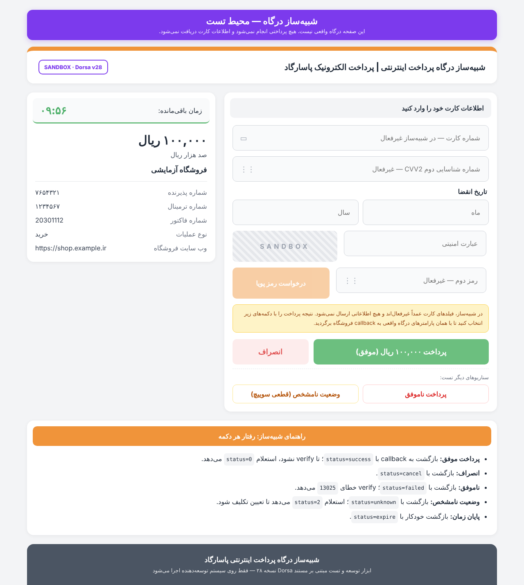

<div dir="rtl">

# PEP IPG MCP

**سرور MCP درگاه پرداخت اینترنتی پرداخت الکترونیک پاسارگاد (PEP)** — دستیار هوش مصنوعی خود را مستقیماً به مستندات درگاه وصل کنید.

[](https://github.com/pep-ipg/pep-ipg-mcp/actions/workflows/ci.yml)
[](LICENSE)
[](https://modelcontextprotocol.io)


یک سرور [MCP](https://modelcontextprotocol.io) که Claude Code، Cursor، Claude Desktop، VS Code و هر ابزار سازگار با MCP را به مستندات **پروتکل Dorsa نسخه 28.0** درگاه پرداخت الکترونیک پاسارگاد متصل می‌کند. دستیار به‌جای حدس زدن، قرارداد دقیق هر سرویس، فیلدهای اجباری، نمونه درخواست و پاسخ و معنی هر کد خطا را از منبع می‌خواند.

---


مدل‌های زبانی مستندات درگاه‌های ایرانی را یا ندیده‌اند یا نسخه قدیمی آن را دیده‌اند. نتیجه:

- پیشنهاد **امضای RSA/XML** درگاه قدیمی، درحالی‌که Dorsa با **JWT Bearer** کار می‌کند
- ارسال `amount` به‌صورت رشته یا تومان، فرستادن کل `url` به‌جای `urlId`
- تحویل خدمت بر اساس `status=success` در callback بدون verify سمت سرور
- تفسیر اشتباه کدهایی مثل `13029`، `13402` یا `13428`

این سرور همین شکاف را پر می‌کند.

## ابزارها

| ابزار | کاربرد |
|---|---|
| `search_docs` | جستجوی فارسی و انگلیسی در همه مستندات |
| `get_doc` | قرارداد کامل هر سرویس: مسیر، فیلدها، نمونه درخواست و پاسخ |
| `get_error_code` | توضیح ۲۰۲ کد خطا و وضعیت، با راه رفع |
| `get_auth_flow` | احراز هویت JWT و کلاینت توکن آماده (TypeScript / Go / PHP / Python) |
| `validate_request` | بررسی بدنه درخواست قبل از ارسال: فیلدها، نوع داده، تسهیم، شبا، کد ملی، urlId |
| `next_action` | تصمیم درست بعد از callback، استعلام یا verify: تحویل، verify، reverse یا refund |
| `sandbox_*` | **شبیه‌ساز محلی درگاه** برای تست کامل بدون ترمینال واقعی (پایین‌تر) |

همه ابزارهای مستندات فقط‌خواندنی‌اند و به درگاه واقعی وصل نمی‌شوند.

## پوشش مستندات

| حوزه | سرویس‌ها |
|---|---|
| احراز هویت | `get-token`، `authorization` (قوی / بورسی) |
| ثبت پرداخت | `purchase` (عادی و شناسه‌دار)، `multiacc-purchase` (تسهیم تا ۱۰ شبا)، `multiacc-payment-code` (شناسه‌دار با تسهیم)، `topup-bill` (شارژ، بسته اینترنتی، قبض) |
| تعیین تکلیف | `verify-transactions`، `verify-payment`، `confirm-payment`، `reverse-payment` |
| استعلام | `payment-inquiry`، `payment-inquiry-v2` |
| بازگشت وجه | `refund-transactions`، Refund از طریق Provider (toman / پاد) و سرویس‌های پیگیری تسویه |
| خدمات کارت | `inquiry-confirm-pin`، `inquiry-mini-statement` |
| راهنماها | `overview`، `authentication`، `purchase-flows`، `settlement`، `callback-inquiry`، `referer`، `refund`، `pitfalls`، `security` |

---

## نصب سریع (پیشنهادی)

مستندات کامل درگاه به‌صورت **Skill** مستقیماً از همین مخزن نصب می‌شود.

### Claude Code: به‌عنوان Plugin

```
/plugin marketplace add pep-ipg/pep-ipg-mcp
/plugin install pep-ipg@pep-ipg
```

Plugin هم Skill و هم سرور MCP (با شبیه‌ساز) را نصب می‌کند؛ سرور MCP به Node.js 18+ نیاز دارد. بعد از نصب، Claude هر وقت درباره درگاه پاسارگاد سؤال یا کدی باشد خودش از آن‌ها استفاده می‌کند. فراخوانی مستقیم: `/pep-ipg`

### یا فقط از Claude بخواهید

این را در Claude Code بنویسید:

```
https://github.com/pep-ipg/pep-ipg-mcp
این Skill را نصب کن.
```

### Codex و سایر ابزارهای سازگار با Agent Skills

```bash
npx skills add pep-ipg/pep-ipg-mcp -a codex
```

### claude.ai (وب، دسکتاپ، موبایل)

فایل [`pep-ipg-skill.zip`](https://github.com/pep-ipg/pep-ipg-mcp/releases/latest/download/pep-ipg-skill.zip) را دانلود کنید و در بخش **Skills** تنظیمات Claude بارگذاری کنید.

### دستی

```bash
git clone https://github.com/pep-ipg/pep-ipg-mcp.git
cp -r pep-ipg-mcp/skills/pep-ipg ~/.claude/skills/
```

---

## نصب به‌صورت MCP Server

> پیش‌نیاز: [Node.js](https://nodejs.org) نسخه 18 یا بالاتر. برای Claude Desktop (روش یک‌کلیکی) لازم نیست.

### Claude Code

```bash
claude mcp add pep -- npx -y pep-ipg-mcp
claude mcp list   # بررسی اتصال
```

### Claude Desktop

**روش یک‌کلیکی:** فایل [`pep-ipg-mcp.mcpb`](https://github.com/pep-ipg/pep-ipg-mcp/releases/latest/download/pep-ipg-mcp.mcpb) را دانلود کنید و روی آن دابل‌کلیک کنید. سپس در پنجره بازشده **Install** را بزنید.

**روش دستی:** در `Settings → Developer → Edit Config`:

```json
{
  "mcpServers": {
    "pep": {
      "command": "npx",
      "args": ["-y", "pep-ipg-mcp"]
    }
  }
}
```

### Cursor

`Settings → MCP → Add Server` یا فایل `~/.cursor/mcp.json`:

```json
{
  "mcpServers": {
    "pep": {
      "command": "npx",
      "args": ["-y", "pep-ipg-mcp"]
    }
  }
}
```

### VS Code (Copilot)

فایل `.vscode/mcp.json`:

```json
{
  "servers": {
    "pep": {
      "type": "stdio",
      "command": "npx",
      "args": ["-y", "pep-ipg-mcp"]
    }
  }
}
```

### Codex (CLI و افزونه IDE)

```bash
codex mcp add pep -- npx -y pep-ipg-mcp
```

یا در `~/.codex/config.toml`:

```toml
[mcp_servers.pep]
command = "npx"
args = ["-y", "pep-ipg-mcp"]
```

### Windsurf / سایر ابزارها

هر ابزاری که MCP از نوع stdio را پشتیبانی کند، با دستور `npx -y pep-ipg-mcp` کار می‌کند.

### سرور آنلاین (یک آدرس برای همه)

سرور را یک‌بار اجرا کنید تا همه فقط با یک آدرس وصل شوند، بدون نصب:

[](https://render.com/deploy?repo=https://github.com/pep-ipg/pep-ipg-mcp)

یا روی سرور خودتان با Docker:

```bash
docker run -d -p 3000:3000 --restart unless-stopped ghcr.io/pep-ipg/pep-ipg-mcp:latest
```

اتصال:

```bash
claude mcp add --transport http pep https://YOUR-HOST/mcp
```

در **ChatGPT** (پلن‌های پولی، با Developer Mode): همین آدرس را در بخش Connectors اضافه کنید. شبیه‌ساز در حالت آنلاین در دسترس نیست و فقط روی سیستم خود توسعه‌دهنده اجرا می‌شود.

## شبیه‌ساز درگاه (Sandbox)

یک شبیه‌ساز محلی از پروتکل Dorsa v28 که روی سیستم خود توسعه‌دهنده اجرا می‌شود. کد پذیرنده را به آن وصل کنید و کل چرخه را بدون ترمینال، کارت و اینترنت تست کنید.



**از داخل دستیار هوش مصنوعی** (نسخه MCP): کافی است بگویید «با شبیه‌ساز تستش کن». ابزارها:

| ابزار | کار |
|---|---|
| `sandbox_start` | اجرای شبیه‌ساز و گرفتن base URL و اطلاعات ورود تست |
| `sandbox_pay` | نقش خریدار: پرداخت موفق، ناموفق، نامشخص، انصراف یا انقضا، و فراخوانی callback |
| `sandbox_status` | تراکنش‌ها، وضعیت هر کدام، درخواست‌های کد پذیرنده و هشدارهای Referer |
| `sandbox_inject` | تزریق خطا: کد خطای دلخواه، timeout، یا «انجام شد ولی پاسخ گم شد» |
| `sandbox_configure` | بررسی Referer، مهلت‌ها و **جلو بردن ساعت** برای تست انقضا |
| `sandbox_resolve` / `sandbox_reset` | تعیین تکلیف تراکنش نامشخص / پاک کردن همه‌چیز |

**بدون دستیار:**
```bash
npx -p pep-ipg-mcp pep-ipg-sandbox            # http://127.0.0.1:8787
```
```
PEP_BASE_URL=http://127.0.0.1:8787   PEP_USERNAME=sandbox   PEP_PASSWORD=sandbox   PEP_TERMINAL_NUMBER=1234567
```

**سناریوهایی که روی درگاه واقعی تقریباً قابل بازسازی نیستند:** تراکنش نامشخص و تعیین تکلیف بعدی، verify که انجام شد ولی پاسخش نرسید، verify تکراری (13428)، برگشت خودکار به‌خاطر نزدن verify (13075)، اتمام مهلت reverse (13076)، توکن منقضی (13008)، Referer نامعتبر (13402)، invoice تکراری (13003) و Refund بیش از مبلغ (13395).

**استفاده در Docker Compose، سرور تست تیمی و CI:** [`docs/sandbox.md`](docs/sandbox.md)

> شبیه‌ساز رفتار درگاه را بر اساس مستند Dorsa تقلید می‌کند. صفحه پرداختش عمداً اطلاعات کارت نمی‌گیرد. قبل از Go-Live، تست نهایی را روی ترمینال واقعی انجام دهید.

---

## نمونه استفاده

بعد از اتصال، به زبان طبیعی بپرسید:

- «با درگاه پاسارگاد یک سرویس پرداخت در Laravel بنویس: getToken، purchase، callback و verify-payment.»
- «خطای 13402 می‌گیرم، مشکل چیست؟»
- «callback نیامد و کاربر مرورگر را بست؛ تراکنش را چطور تعیین تکلیف کنم؟»
- «خرید با تسهیم بین سه شبا با نسبت 50/30/20 را در Node.js پیاده کن.»

نمونه‌های بیشتر: [`examples/prompts.md`](examples/prompts.md)

---

## عیب‌یابی

| مشکل | راه‌حل |
|---|---|
| سرور در فهرست ابزارها نیست | `claude mcp list` را بزنید؛ `npx -y pep-ipg-mcp` را یک‌بار در ترمینال اجرا کنید تا خطای احتمالی دیده شود |
| `spawn npx ENOENT` در Claude Desktop | از روش یک‌کلیکی (`.mcpb`) استفاده کنید، یا مسیر کامل خروجی `which npx` را به‌جای `npx` بگذارید |
| `npx` در ایران کند است یا خطا می‌دهد | registry را عوض کنید یا از روش `.mcpb` استفاده کنید که اینترنت لازم ندارد |
| دستیار از ابزار استفاده نمی‌کند | صریح بگویید: «با ابزار pep بررسی کن» |

## ساختار پروژه

```
data/
  docs/            مستندات Markdown (هر سرویس و راهنما یک فایل)
  errors.json      جدول کامل کدهای خطا
  endpoints.json   قرارداد ساخت‌یافته سرویس‌ها (برای اعتبارسنجی و شبیه‌ساز)
src/
  server.ts        Express + Streamable HTTP (stateless) + /health
  auth.ts          احراز هویت اختیاری با توکن Bearer
  spec.ts / validate.ts / decision.ts   قرارداد سرویس‌ها، اعتبارسنجی و تصمیم‌گیری
  sandbox/         شبیه‌ساز درگاه (node:http، بدون وابستگی)
  sandbox-cli.ts   اجرای مستقل شبیه‌ساز
  stdio.ts         اجرای محلی
  mcp.ts           تعریف ابزارها (SDK رسمی MCP)
  tools.ts         منطق ابزارها، مستقل از SDK و قابل تست
  types.ts
test/              تست‌ها (node:test)
manifest.json      پیکربندی افزونه Claude Desktop (.mcpb)
.claude-plugin/    Plugin و Marketplace برای Claude Code
skills/pep-ipg/    Skill (SKILL.md + references، ساخته‌شده از data/ با npm run build:skill)
docker-compose.yml اجرای سرور HTTP با Docker
deploy/            نمونه Nginx (HTTPS) و systemd
```

## توسعه

```bash
git clone https://github.com/pep-ipg/pep-ipg-mcp.git && cd pep-ipg-mcp
npm install
npm run dev        # hot reload
npm test
npm run inspect    # MCP Inspector
```

برای اصلاح یا افزودن مستند، [`CONTRIBUTING.md`](CONTRIBUTING.md) را ببینید.

## امنیت

هرگز شماره کارت، CVV2، رمز دوم یا credential ترمینال را در issue، PR یا گفت‌وگو با دستیار هوش مصنوعی وارد نکنید. گزارش آسیب‌پذیری: [`SECURITY.md`](SECURITY.md)

## سلب مسئولیت

این سرور برای راهنمایی توسعه‌دهندگان در پیاده‌سازی است. مرجع نهایی، مستند رسمی پرداخت الکترونیک پاسارگاد و تیم فنی شرکت است. مقادیر نمونه ساختگی‌اند. مهلت‌ها (verify، reverse) و سایر تنظیمات را برای ترمینال خود از تیم فنی بگیرید.

## مجوز

[MIT](LICENSE)

</div>
